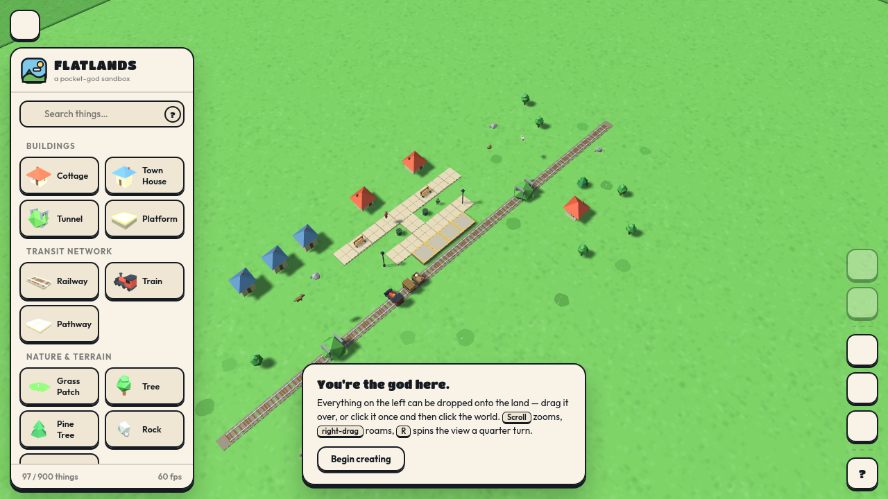
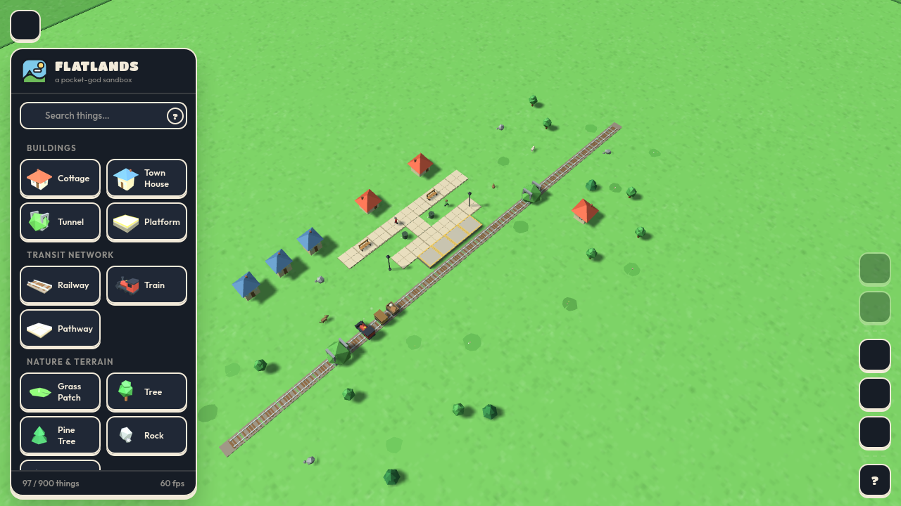

# Flatlands — A Pocket-God Sandbox

[](#-automated-test-suite)
[](https://threejs.org/)
[](#-running-the-game)
[-lightgrey)](LICENSE)

**Flatlands** is a delightful, browser-based 3D god-sandbox game built with [Three.js](https://threejs.org/). You are given an 80×80 plot of vibrant low-poly countryside to shape however you see fit: lay auto-interlocking railways, build cottages and townhouses, plant forests, and watch citizens, dogs, cats, and ducks roam around your miniature living world.

Everything runs entirely client-side with zero build steps or bundlers required. Simply launch [index.html](index.html) or [3dsandbox.html](3dsandbox.html) in any modern desktop browser.

---

## 📸 Visual Showcase

### Daytime Town Overview

*Initial Genesis starter town featuring cottages, elevated station platform, railway with tunnel, streetlights, and autonomous citizens.*

### GitHub Dark Theme

*The running railway network, active locomotive pulling carriages, and dark slate UI palette.*

---

## 🌟 Key Features & What You Can Do

### 1. Construction & Creative Placement
- **Drag-and-Drop or Click-to-Place:** Drag any item from the left sidebar onto the terrain, or click an item once to hold it and click anywhere in the world to drop it.
- **Continuous Ground Painting:** Hold left-click and drag across the ground to paint continuous railway lines, stone pathways, elevated station platforms, or lush flower-speckled grass patches.
- **Rotation in Hand:** Press <kbd>Q</kbd> / <kbd>E</kbd> or <kbd>Ctrl</kbd>+<kbd>R</kbd> to rotate objects in 45° increments before placing them.
- **Placement Ghost & Safety Guard:** A live ghost preview tracks your cursor. An emerald-green ground marker indicates a valid drop, while a pink-red marker (`#ff9a8a`) and ghost tint warn against overlaps or out-of-bounds drops.

### 2. Living Railway & Transit Network
- **Auto-Interlocking Tracks:** Rail tiles automatically detect neighboring tracks and dynamically re-mesh into straightaways, corners, T-junctions, and crossings.
- **Working Trains:** Place a train engine onto any rail. It pulls passenger and cargo cars along an articulated breadcrumb trail, wheels spin with movement, and steam puffs billow from the smokestack.
- **Dead-End Shuttles:** Trains automatically reverse direction when reaching dead ends or circle indefinitely on closed loops.
- **Tunnels:** Place tunnels over straight tracks; they snap to the track's orientation and trains dive through them.

### 3. Autonomous World Simulation
- **Citizens & Creatures:** Spawn humans, cats, dogs, and ducks. They wander autonomously using probe-based obstacle avoidance and procedural limb-rig animations.
- **Wall-Collision Guard & No Clipping:** Wanderers detect solid structures and slide tangentially along walls without clipping inside buildings.
- **Pathway Preferences & Stepping Heights:** Wanderers favor stone pathways and elevated station platforms, naturally stepping up onto raised curbs and rail beds.
- **Interactive Town Mechanics:** Place trash bins near walkways—passing citizens will pause to dispose of litter with particle puffs and satisfying feedback.

### 4. God Powers & World Editing
- **Object Inspection:** Click any placed object to target it with animated selection brackets and open a contextual floating menu.
- **Rotate, Resize & Smite:**
  - Rotate objects by 90° increments.
  - Scale objects from **55%** up to **190%** of their original size.
  - "Smite" (delete) unwanted objects instantly or press <kbd>Delete</kbd> / <kbd>Backspace</kbd>.
- **Full History (Undo / Redo):** Press <kbd>Ctrl</kbd>+<kbd>Z</kbd> to undo and <kbd>Ctrl</kbd>+<kbd>Y</kbd> to redo actions (up to 120 steps).
- **Reset & Restart:**
  - **Flatten the world:** Clears all placed items for a clean slate.
  - **Restart the game:** Sweeps the world clean and re-runs the full 97-object falling "Genesis" drop sequence.

### 5. Camera & Navigation
- **Right-Drag Roam:** Hold the right mouse button to pan smoothly across the terrain without interfering with left-click placement.
- **Scroll Zoom:** Use mouse wheel or the HUD zoom buttons for fluid perspective zoom.
- **Spin the View:** Press <kbd>R</kbd> or click the rotate button for a smooth 90° quarter-turn view spin.
- **Keyboard Drift:** Use <kbd>W</kbd><kbd>A</kbd><kbd>S</kbd><kbd>D</kbd> or Arrow keys to drift across the landscape.

### 6. Themes & Customization
- **Theme Segments:** Switch between **Warm White** (paper-toned light theme) and **GitHub Dark** (sleek slate theme).
- **World Toggles:** Toggle real-time directional shadows, grid lines, floating clouds, and synthesized procedural sound effects on the fly.
- **Real-Time HUD:** Live stats show current world population against the 900-object capacity limit and real-time FPS.

---

## 🕹️ Controls Reference

| Action | Control | Description |
|---|---|---|
| **Hold / Select Asset** | Left-click sidebar icon | Selects item to carry in cursor hand |
| **Drop Held Asset** | Left-click valid terrain | Places asset at target grid coordinate |
| **Paint Ground** | Left-drag ground assets | Continuously paints rails, paths, grass, or platforms |
| **Rotate in Hand** | <kbd>Q</kbd> / <kbd>E</kbd> or <kbd>Ctrl</kbd>+<kbd>R</kbd> | Rotates carried item in 45° steps |
| **Cancel / Put Away** | <kbd>Esc</kbd> or quick Right-click | Clears carried item without placing |
| **Pan Camera** | Right-click and drag | Roams across terrain smoothly |
| **Zoom View** | Mouse scroll wheel or HUD `+` / `-` | Zooms perspective between 18 and 92 units |
| **Rotate View 90°** | <kbd>R</kbd> or HUD spin button | Quarter-turns camera angle with smooth damping |
| **Drift Camera** | <kbd>W</kbd> <kbd>A</kbd> <kbd>S</kbd> <kbd>D</kbd> or Arrow Keys | Pans camera smoothly across the axes |
| **Select Placed Object** | Left-click placed object | Opens contextual god-menu with brackets |
| **Smite (Delete)** | <kbd>Delete</kbd> / <kbd>Backspace</kbd> or trash button | Instantly removes selected object |
| **Undo** | <kbd>Ctrl</kbd>+<kbd>Z</kbd> | Reverts last placement, transform, or deletion |
| **Redo** | <kbd>Ctrl</kbd>+<kbd>Y</kbd> or <kbd>Ctrl</kbd>+<kbd>Shift</kbd>+<kbd>Z</kbd> | Restores reverted action |

---

## 📦 Asset Catalog

The game features 19 procedural low-poly assets across 5 categories with zero external 3D model dependencies:

- 🏛️ **Buildings:** Cottage, Town House, Tunnel, Elevated Station Platform.
- 🚂 **Transit Network:** Railway (dynamic auto-turn meshes), Locomotive Engine (with Passenger & Cargo Cars), Pathway.
- 🌲 **Nature & Terrain:** Grass Patch (with flowers), Oak Tree, Pine Tree, Rock, Boulder.
- 🪑 **Street & Decor:** Park Bench, Streetlight (with emissive bulb), Trash Bin.
- 🐾 **Life:** Human (multi-skin/shirt variants), Cat, Dog, Duck.

---

## 💻 Requirements & System Support

- **Browser:** Any modern desktop browser supporting WebGL 1.0/2.0 and ES6 modules (Google Chrome, Mozilla Firefox, Microsoft Edge, Apple Safari).
- **Graphics:** Any hardware or software GPU supporting WebGL. Verified at 60 FPS under software Mesa/SwiftShader WebGL.
- **Dependencies:** All runtime dependencies (`three.js` r128, `lucide` icons, and Google Fonts) are linked via standard CDNs.

---

## 🚀 Running the Game

### Method 1: Direct File Launch
Simply double-click or open [3dsandbox.html](3dsandbox.html) or [index.html](index.html) in your browser.

### Method 2: Local HTTP Server (Recommended)
Running through an HTTP server ensures consistent asset and font loading:
```bash
# Using Python 3
python3 -m http.server 8000

# Or using Node.js serve
npx serve .
```
Then navigate your browser to `http://localhost:8000/`.

---

## 🧪 Automated Test Suite

Flatlands is backed by a comprehensive **129-test automated test harness** verified with zero failures.

```bash
# 1. Run core systems & invariant tests (53 tests)
node audit/test-core-suite.mjs

# 2. Run history & undo/redo stress tests (13 tests)
node audit/test-history-stress.mjs

# 3. Run simulation & crowd stress tests (13 tests)
node audit/stress-suite.mjs

# 4. Run 12,000-tick wall-clipping collision guard test (1 test)
node audit/test-guard.mjs

# 5. Run adversarial red-team audit suite via Playwright (41 tests)
node audit/redteam-audit-suite.mjs

# 6. Run full browser E2E interaction test
node audit/e2e.mjs

# 7. Run camera roam, drag-paint, and keyboard input E2E test
node audit/e2e-inputs.mjs
```

For detailed test specifications, architecture, and benchmark measurements, see [docs/TESTING.md](docs/TESTING.md).

---

## 📚 Project Documentation

- [docs/ARCHITECTURE.md](docs/ARCHITECTURE.md) — Comprehensive technical design of the renderer, procedural geometry pipeline, railway graph, entity AI, and history command stack.
- [docs/TESTING.md](docs/TESTING.md) — Detailed guide to the test suite, test harness architecture, invariant checks, and performance numbers.
- [docs/KNOWN_ISSUES.md](docs/KNOWN_ISSUES.md) — Transparent record of environmental limitations, software WebGL nuances, and cosmetic observations.
- [docs/CHANGELOG.md](docs/CHANGELOG.md) — Full version history tracking baseline creation, GLM 5.3 Flash defect fixes, Gemini 3.8 adversarial audit repairs, and Claude Sonnet 4.6 release engineering.
- [LICENSE](LICENSE) — Project licensing notice and third-party open-source attributions (Three.js MIT, Lucide ISC, Google Fonts OFL).

---

## 🤝 Contributing

Contributions, bug reports, and enhancements are welcome! Please follow these guidelines:
1. Ensure all proposed changes keep the core game self-contained in `3dsandbox.html`.
2. Run the complete automated test suite (`node audit/test-core-suite.mjs`, etc.) before submitting changes.
3. Add regression tests in `audit/` for any new bug fixes or feature additions.
4. Open an issue or pull request with clear reproduction steps and test results.
